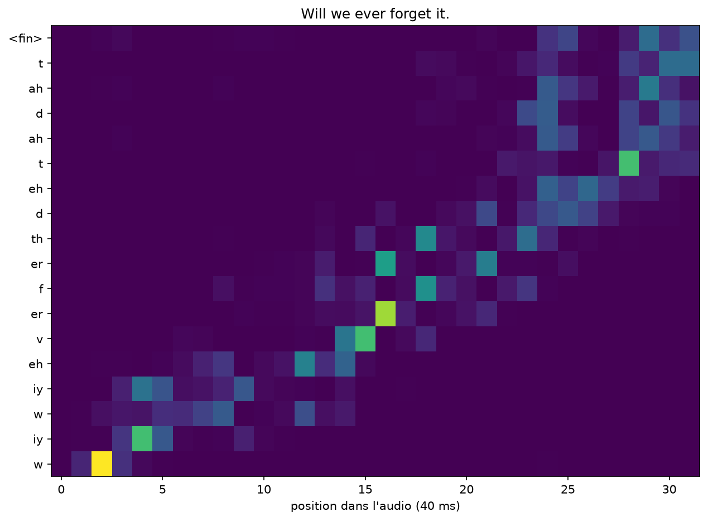

# Let-It-Attend

Un Transformer encodeur-décodeur écrit à la main en PyTorch : il écoute une phrase (CMU ARCTIC) et écrit ses phonèmes.

```bash
pip install -r requirements.txt
python entrainer.py
python demo.py
```

**44 % d'erreur** sur les phonèmes de 111 phrases jamais entendues, après 50 minutes d'audio.


